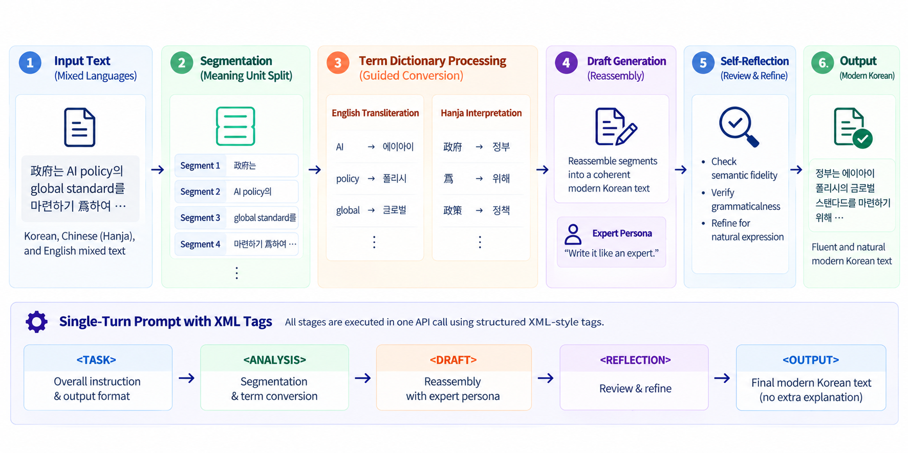

## Language Modernization — MIXUP Prompathon 2025

**2025 MIXUP Datathon | Language Modernization Track | 3rd Place 🥉**

### 1. Introduction

This project develops a structured prompt-engineering approach to transform mixed Korean, Classical Chinese characters (Hanja), and English expressions into fluent modern Korean while preserving the original meaning.

Rather than relying on direct, single-step rewriting, we designed a **task-decomposed, single-turn prompting pipeline** that combines semantic segmentation, glossary-guided conversion, draft generation, and self-refinement.

### 2. Key Features

1. **Semantic Segmentation:** Divides complex source text into meaningful units to reduce contextual ambiguity and support accurate rewriting.
2. **Glossary-Guided Language Conversion:** Uses explicit transliteration rules for English expressions and a Hanja interpretation structure connecting characters, pronunciation, meaning, and modern Korean equivalents.
3. **Structured Draft Generation:** Reassembles processed segments into coherent sentences and applies an expert-writing instruction to improve readability and grammatical fluency.
4. **Self-Reflection and Refinement:** Introduces a dedicated review stage to check semantic preservation and grammatical correctness.
5. **XML-Tagged Single-Turn Prompting:** Organizes analysis, drafting, and reflection within a single API request using explicit XML-style stage delimiters.

### 3. System Architecture

### 4. Results

#### Experimental Findings

| Experiment | Reported Score |
|---|---:|
| Initial baseline | 0.6820 |
| Few-shot prompting with low-scoring examples | 0.5360 |
| Multi-turn approach evaluated during optimization | 0.4360 |

Adding few-shot examples did not improve performance. This finding motivated a shift toward decomposing the modernization task into explicit stages rather than increasing the number of examples.

The team ultimately prioritized a structured single-turn approach to reduce repeated API calls while retaining analysis, drafting, and reflection within one prompt.

#### Competition Achievement

**3rd Place — 2025 MIXUP Datathon**

The project presentation's leaderboard shows the team's final overall score as approximately **0.7760**.

### 5. My Contributions

**Minsuh Joo: Prompt Optimization**

- **Prompt Optimization:** Collaborated on refining the prompt architecture to improve the stability and consistency of generated modern Korean text.
- **Output Reliability:** Contributed to optimizing the final prompting strategy, focusing on reproducible execution and consistent outputs.
